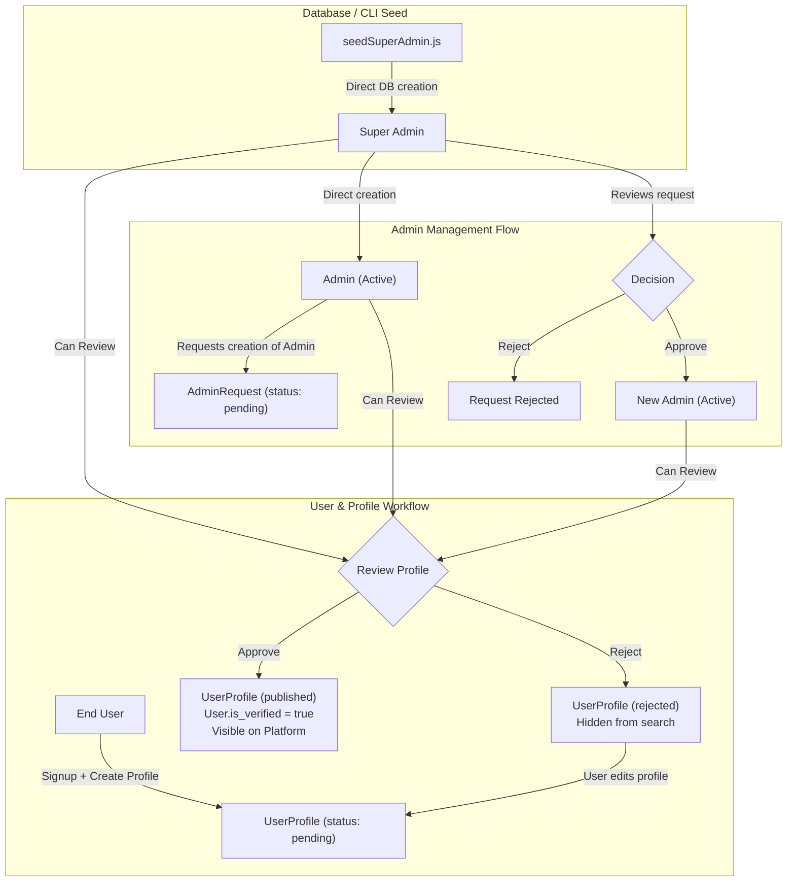
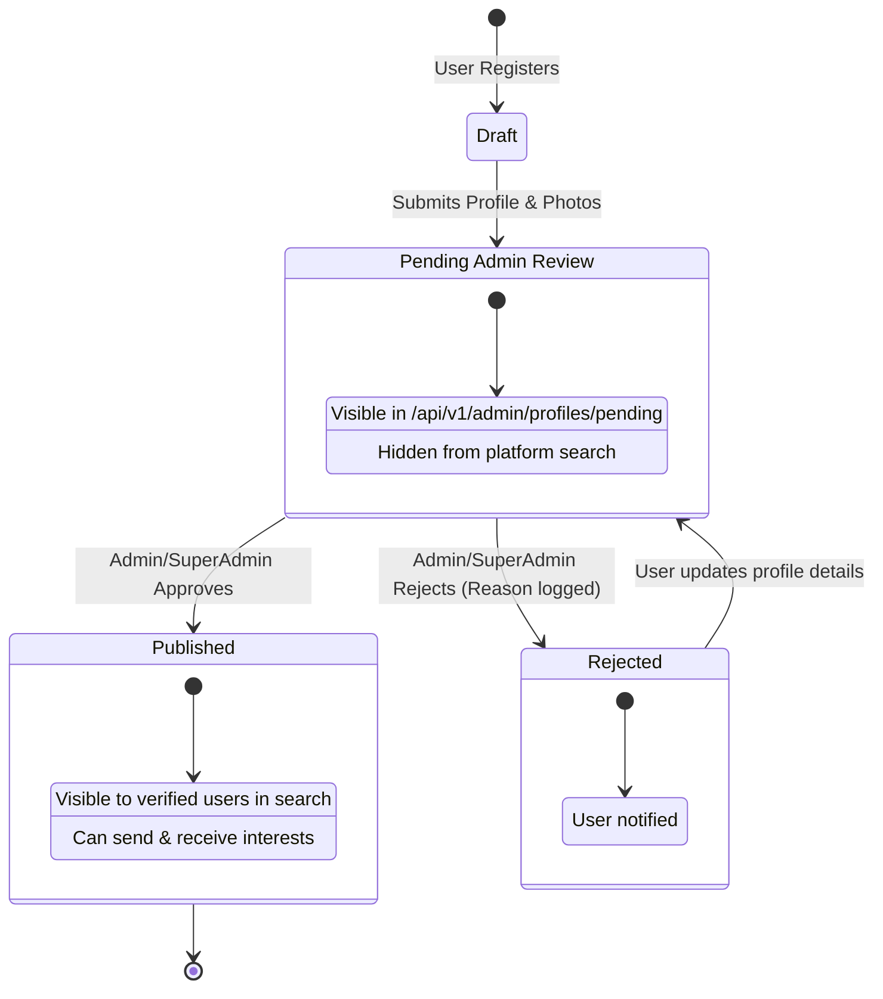
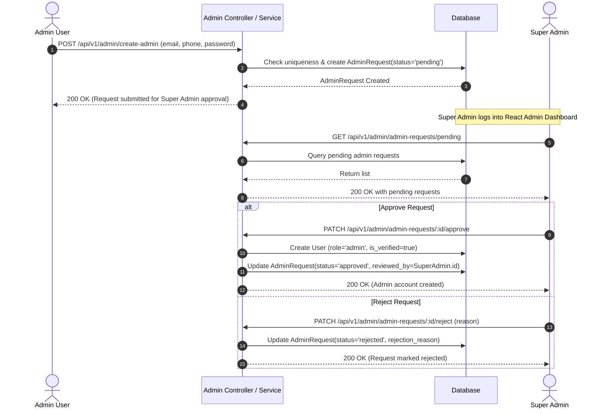

# Admin & Super Admin Role-Based Access Control (RBAC) Specification

This document details the architecture, workflows, database models, permissions matrix, and API endpoints for the Admin & Super Admin RBAC system in the Matrimonial Application. It is designed to serve as the definitive reference for backend maintenance and for building the standalone React Admin & Super Admin Dashboard.

---

## 1. Role Hierarchy & Conceptual Model

The platform enforces a strict three-tier hierarchy:

1. **Super Admin**
   - Seeded directly in the database (or created via CLI script). Cannot be created via public API.
   - Holds all administrative privileges plus exclusive governance permissions.
   - Can directly create Admin users without approval.
   - Can review, approve, or reject Admin creation requests initiated by Admins.
   - Can view system-wide dashboard metrics and audit lists of all admins.

2. **Admin**
   - Created either directly by a Super Admin or through approval by a Super Admin.
   - Can request the creation of other Admins (creates a pending `AdminRequest`).
   - Reviews and verifies newly registered user profiles (inspecting details and photos).
   - Approves (`published`) or rejects (`rejected`) user profiles.
   - Accesses operational metrics and profile lists.
   - Can view peer Admin accounts, but cannot view or manage Super Admin accounts or change any Admin account.

3. **User**
   - Self-registers via the public sign-up route (`/api/v1/auth/signup`).
   - Profile starts with status `pending`.
   - Cannot view other users or be discovered in searches until their profile has been reviewed and verified by an Admin (`published`).
   - If rejected, can update profile details which resets status to `pending` for re-review.

---

## 2. Mermaid Architecture & Workflows

### 2.1 Role Hierarchy & Creation Flow



### 2.2 User Profile Verification State Diagram



### 2.3 Admin Creation Request Sequence Diagram



---

## 3. Database Models & Schema Changes

### 3.1 `users` Table
- `role`: `ENUM('super_admin', 'admin', 'user')` (default: `'user'`)
- `is_verified`: `BOOLEAN` (default: `false` — becomes `true` upon profile approval)
- `status`: `ENUM('active', 'inactive', 'blocked')` (default: `'active'`)

### 3.2 `user_profiles` Table
- `profile_status`: `ENUM('pending', 'published', 'rejected')` (default: `'pending'`)
- Profiles are linked `1:1` with `users`. Only profiles with `profile_status = 'published'` are returned in search and browse queries.

### 3.3 `admin_requests` Table
Tracks admin user creation requests made by existing Admins awaiting Super Admin review:

| Column | Type | Attributes | Description |
|--------|------|------------|-------------|
| `id` | BIGINT UNSIGNED | PK, Auto Increment | Unique request ID |
| `requested_by` | BIGINT UNSIGNED | FK -> `users.id`, NOT NULL | Admin who initiated the request |
| `email` | VARCHAR(255) | NULL | Target email for new admin |
| `phone` | VARCHAR(20) | NULL | Target phone for new admin |
| `password_hash` | VARCHAR(255) | NOT NULL | Pre-hashed password |
| `status` | ENUM('pending', 'approved', 'rejected') | DEFAULT 'pending' | Status of request |
| `reviewed_by` | BIGINT UNSIGNED | FK -> `users.id`, NULL | Super admin who reviewed |
| `reviewed_at` | DATETIME | NULL | Timestamp of review |
| `rejection_reason` | VARCHAR(500) | NULL | Reason if rejected |
| `created_at` | DATETIME | Automatic | Request creation timestamp |
| `updated_at` | DATETIME | Automatic | Request update timestamp |

---

## 4. Permissions Matrix

| Feature / Endpoint | Super Admin | Admin | User |
|-------------------|:-----------:|:-----:|:----:|
| Login (`/api/v1/auth/login`) | ✅ | ✅ | ✅ |
| View Dashboard Stats (`/api/v1/admin/dashboard/stats`) | ✅ (All stats) | ✅ (Profile stats only) | ❌ |
| Get Pending Profiles Count (`/api/v1/admin/profiles/pending/count`) | ✅ | ✅ | ❌ |
| List Pending Profiles (`/api/v1/admin/profiles/pending`) | ✅ | ✅ | ❌ |
| Filter/Search Profiles (`/api/v1/admin/profiles`) | ✅ | ✅ | ❌ |
| Approve Profile (`/api/v1/admin/profiles/:userId/approve`) | ✅ | ✅ | ❌ |
| Reject Profile (`/api/v1/admin/profiles/:userId/reject`) | ✅ | ✅ | ❌ |
| Create Admin (`/api/v1/admin/create-admin`) | ✅ (Direct) | ✅ (Creates request) | ❌ |
| List Pending Admin Requests (`/api/v1/admin/admin-requests/pending`) | ✅ | ❌ | ❌ |
| Approve Admin Request (`/api/v1/admin/admin-requests/:id/approve`) | ✅ | ❌ | ❌ |
| Reject Admin Request (`/api/v1/admin/admin-requests/:id/reject`) | ✅ | ❌ | ❌ |
| List Admins (`/api/v1/admin/admins`) | ✅ (Admins and Super Admins) | ✅ (Peer Admins only) | ❌ |
| Update Admin (`PATCH /api/v1/admin/admins/:id`) | ✅ (Regular Admin only) | ❌ | ❌ |
| Deactivate Admin (`DELETE /api/v1/admin/admins/:id`) | ✅ (Regular Admin only) | ❌ | ❌ |
| Browse/Search Profiles (`/api/v1/users/search`) | ❌ (Client app) | ❌ (Client app) | ✅ (Only published) |

---

## 5. Admin API Reference (For React Dashboard)

All admin endpoints require an `Authorization: Bearer <token>` header.

### 5.1 Dashboard Stats
- **URL**: `GET /api/v1/admin/dashboard/stats`
- **Access**: Admin, Super Admin
- **Response**:
```json
{
  "success": true,
  "data": {
    "total_users": 150,
    "profiles": {
      "pending": 8,
      "published": 135,
      "rejected": 7
    },
    "total_admins": 4,             // included for super_admin only
    "pending_admin_requests": 2    // included for super_admin only
  }
}
```

---

### 5.2 Pending Profiles Count
- **URL**: `GET /api/v1/admin/profiles/pending/count`
- **Access**: Admin, Super Admin
- **Response**:
```json
{
  "success": true,
  "data": {
    "pending_count": 8
  }
}
```

---

### 5.3 List Pending Profiles
- **URL**: `GET /api/v1/admin/profiles/pending?page=1&limit=20`
- **Access**: Admin, Super Admin
- **Response**:
```json
{
  "success": true,
  "data": [
    {
      "id": 12,
      "email": "applicant@example.com",
      "phone": "9876543210",
      "role": "user",
      "status": "active",
      "is_verified": false,
      "UserProfile": {
        "id": 8,
        "first_name": "Rohan",
        "last_name": "Sharma",
        "gender": "male",
        "date_of_birth": "1995-06-15",
        "profile_status": "pending",
        "city": "Mumbai",
        "state": "Maharashtra"
      },
      "CareerDetails": [...],
      "UserEducations": [...],
      "UserPhotos": [
        { "id": 1, "photo_url": "uploads/user-12-1.jpg", "is_primary": true }
      ]
    }
  ],
  "pagination": {
    "total": 8,
    "page": 1,
    "limit": 20,
    "total_pages": 1
  }
}
```

---

### 5.4 Search / Filter All Profiles
- **URL**: `GET /api/v1/admin/profiles?status=pending&search=Rohan&page=1&limit=20`
- **Access**: Admin, Super Admin
- **Query Params**:
  - `status`: `pending` | `published` | `rejected`
  - `search`: search term matching email or phone
  - `page`: page number (default: 1)
  - `limit`: results per page (default: 20)

---

### 5.5 Approve User Profile
- **URL**: `PATCH /api/v1/admin/profiles/:userId/approve`
- **Access**: Admin, Super Admin
- **Response**:
```json
{
  "success": true,
  "message": "Profile approved and published successfully",
  "data": {
    "user_id": "12",
    "profile_status": "published",
    "approved_by": 1
  }
}
```

---

### 5.6 Reject User Profile
- **URL**: `PATCH /api/v1/admin/profiles/:userId/reject`
- **Access**: Admin, Super Admin
- **Body**:
```json
{
  "reason": "Profile photo is not clear. Please upload a clear passport-size photo."
}
```
- **Response**:
```json
{
  "success": true,
  "message": "Profile rejected successfully",
  "data": {
    "user_id": "12",
    "profile_status": "rejected",
    "rejected_by": 1,
    "reason": "Profile photo is not clear. Please upload a clear passport-size photo."
  }
}
```

---

### 5.7 Create Admin
- **URL**: `POST /api/v1/admin/create-admin`
- **Access**: Admin, Super Admin
- **Body**:
```json
{
  "email": "new.admin@platform.com",
  "phone": "9988776655",
  "password": "TemporaryAdminPass123"
}
```
- **Response (when called by Super Admin - 201 Created)**:
```json
{
  "success": true,
  "message": "Admin created successfully",
  "data": {
    "id": 15,
    "email": "new.admin@platform.com",
    "phone": "9988776655",
    "role": "admin",
    "status": "active"
  }
}
```
- **Response (when called by Admin - 200 OK)**:
```json
{
  "success": true,
  "message": "Admin creation request submitted. Awaiting super admin approval.",
  "data": {
    "request_id": 3,
    "email": "new.admin@platform.com",
    "phone": "9988776655",
    "status": "pending"
  }
}
```

---

### 5.8 List Pending Admin Requests
- **URL**: `GET /api/v1/admin/admin-requests/pending?page=1&limit=20`
- **Access**: Super Admin only
- **Response**:
```json
{
  "success": true,
  "data": [
    {
      "id": 3,
      "email": "new.admin@platform.com",
      "phone": "9988776655",
      "status": "pending",
      "RequestedBy": {
        "id": 2,
        "email": "admin1@platform.com",
        "phone": "9876543210",
        "role": "admin"
      },
      "created_at": "2026-10-31T20:00:00.000Z"
    }
  ],
  "pagination": {
    "total": 1,
    "page": 1,
    "limit": 20,
    "total_pages": 1
  }
}
```

---

### 5.9 Approve Admin Request
- **URL**: `PATCH /api/v1/admin/admin-requests/:id/approve`
- **Access**: Super Admin only
- **Response**:
```json
{
  "success": true,
  "message": "Admin request approved. Admin account created successfully.",
  "data": {
    "request_id": 3,
    "admin": {
      "id": 16,
      "email": "new.admin@platform.com",
      "phone": "9988776655",
      "role": "admin",
      "status": "active"
    },
    "approved_by": 1
  }
}
```

---

### 5.10 Reject Admin Request
- **URL**: `PATCH /api/v1/admin/admin-requests/:id/reject`
- **Access**: Super Admin only
- **Body**:
```json
{
  "reason": "Not authorized to add external administrative personnel at this time."
}
```
- **Response**:
```json
{
  "success": true,
  "message": "Admin request rejected",
  "data": {
    "request_id": 3,
    "status": "rejected",
    "rejected_by": 1,
    "reason": "Not authorized to add external administrative personnel at this time."
  }
}
```

---

### 5.11 List Admins
- **URL**: `GET /api/v1/admin/admins`
- **Access**: Admin, Super Admin
- **Visibility**: Admins see peer Admins only. Super Admins see all active Admin and Super Admin accounts.

### 5.12 Manage Admins
- **Update**: `PATCH /api/v1/admin/admins/:id` (Super Admin only; email, phone, and `active`/`inactive` status for regular Admin accounts).
- **Deactivate**: `DELETE /api/v1/admin/admins/:id` (Super Admin only; soft deletion preserves history).
- Super Admin accounts cannot be changed or deactivated through these endpoints.
- **Response**:
```json
{
  "success": true,
  "data": [
    {
      "id": 2,
      "email": "admin1@platform.com",
      "phone": "9876543210",
      "role": "admin",
      "status": "active",
      "is_verified": true,
      "created_at": "2026-10-15T10:00:00.000Z"
    }
  ]
}
```

---

## 6. Super Admin CLI Provisioning

To seed the initial Super Admin account:

```bash
# Using email
node src/scripts/seedSuperAdmin.js --email superadmin@matrimonial.com --password MasterPassword123

# Using phone
node src/scripts/seedSuperAdmin.js --phone 9999999999 --password MasterPassword123

# Using both email & phone
node src/scripts/seedSuperAdmin.js --email superadmin@matrimonial.com --phone 9999999999 --password MasterPassword123
```

The script verifies uniqueness, hashes the password via bcrypt (10 rounds), sets `role = 'super_admin'`, and ensures only one Super Admin is created this way.
